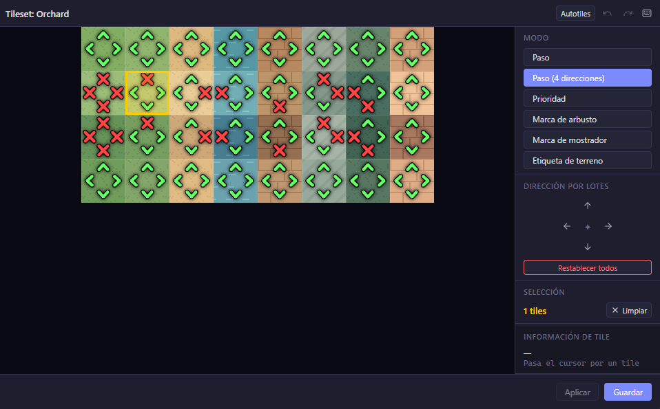

# Editor de tilesets

## Abrir el editor de tilesets

Abre el **Tileset Manager** desde la pestaña **Tilesets** de la Database (**Tools → Database…**, o el botón **Database** de la barra de herramientas). El gestor lista cada tileset (con una lista con búsqueda); selecciona uno y haz clic en **Edit Properties...** para abrir el editor de tilesets para él.

El panel de detalle del gestor muestra además una **miniatura del gráfico del tileset
seleccionado**, así de un vistazo sabes qué tileset vas a editar. El botón **…** junto al nombre
del gráfico abre el selector de gráficos normal, así ves la imagen a la que vas a cambiar —con
zoom, desplazamiento y favoritos— en lugar de elegir a ciegas de una lista de nombres.

Una vía más rápida para un tile que ya tienes a la vista: **clic derecho en ese tile en la
Paleta de tiles → Editar tileset…**. El editor se abre desplazado hasta ese tile exacto y
con él ya seleccionado, en vez de al principio de una hoja larga. Pulsa **Esc** para cerrar
el editor (sigue preguntando por los cambios sin guardar).

**Copiar, cortar y pegar un tileset completo**: clic derecho en una fila de la lista de tilesets para
**Copiar tileset** / **Cortar tileset** / **Pegar tileset (reemplazar)** / **Pegar como nuevo
tileset** / **Duplicar tileset** — ver [Copiar, cortar y pegar registros](database.md#copiar-cortar-y-pegar-registros)
en la documentación de Database. Ninguna está disponible en la fila virtual **Autotiles**. Cortar un
tileset pasa por la misma confirmación de borrado que eliminarlo directamente — otros mapas pueden
seguir usándolo. Haz clic en una fila para dar el foco a la lista, luego Ctrl+C/Ctrl+X/Ctrl+V/Ctrl+J
copian/cortan/pegan/duplican y Ctrl+Z/Ctrl+Y deshacen/rehacen el cambio, incluidas las escrituras a
disco.

**Borrar un tileset** (el icono de papelera en el panel de detalle) ahora pregunta con el mismo
diálogo de confirmación que usa el resto del editor, en lugar de su propia ventana emergente — y
borrar es deshacible: **Ctrl+Z** justo después de confirmar escribe el tileset de vuelta en su
antigua ranura.

(El comando aparte **Map → Change Tileset...** es distinto — intercambia qué tileset usa un *mapa* para sus capas nativas; consulta [Gestión de mapas](map-management.md). No edita las propiedades de los tiles.)

## Resumen

El editor de tilesets te permite modificar las propiedades base de cada tile de un tileset. Son los mismos ajustes que encuentras en RPG Maker XP bajo Database y luego Tilesets. Los cambios hechos aquí se aplican a todos los mapas que usan este tileset.

## Dimensiones de los gráficos

La paleta abre en modo **Ajustar** para los tilesets que todavía no tienen un zoom guardado. Usa **Ctrl + rueda** (**Cmd** en macOS) para cambiar el tamaño. **Ajustar** responde al ancho del panel mientras lo redimensionas. Los cuadros del fondo de transparencia conservan su tamaño a cualquier zoom. Usa **Ajustar** en la cabecera de la paleta para alternar entre ajustar al panel y fijar el tamaño actual. La paleta guarda el modo y el zoom por tileset en este dispositivo. Las celdas miden al menos 16 px, por lo que los tilesets anchos pueden seguir teniendo desplazamiento horizontal. En ambas vistas, mantén pulsado el atajo de **Pan** (Espacio por defecto) o el botón central del ratón y arrastra para moverte, aunque el foco esté en otro control. Ensancha el panel para ver más columnas o arrastra una selección hasta cualquier borde para desplazarla. En el editor de tilesets de la base de datos, usa **Shift + rueda** para desplazarte en horizontal y **Ctrl + rueda** (**Cmd** en macOS) para hacer zoom alrededor del puntero. Cada paso cambia el zoom en la misma proporción, tanto en la paleta como en el editor.

Los tilesets usan las celdas completas de 32×32 del gráfico en su disposición original. Una imagen de 160 px tiene cinco columnas y una de 512 px tiene dieciséis. Si sustituyes un gráfico por otro con distinto número de columnas, los IDs guardados pueden mostrar otros tiles. Instala la integración actualizada de Maker Studio para usar estos gráficos en el juego.

Los autotiles animados usan tiras horizontales de fotogramas de 32×32 o 96×128. El editor y el simulador reproducen la tira completa. La exportación animada admite hasta 384 fotogramas.

## Modos de edición

### Passage (paso)

Haz clic en un tile para alternar entre totalmente transitable (todas las direcciones abiertas) y totalmente bloqueado (mostrado como una x roja). Haz clic derecho para restablecer un tile a su ajuste de paso por defecto.

### Passage (4 direcciones)

Haz clic en uno de los cuatro cuadrantes dentro de un tile para bloquear o desbloquear esa dirección concreta (Arriba, Abajo, Izquierda, Derecha). Cada dirección se puede alternar de forma independiente, dándote control fino sobre exactamente cómo puede moverse el jugador a través de un tile.

### Priority (prioridad)

Haz clic para recorrer los niveles de prioridad 0 a 5:

- **0** = Suelo. El jugador camina por delante del tile.
- **1–5** = Por encima. El jugador camina por detrás del tile (p. ej. copas de árboles), en el juego y en el Simulador.

**Cada nivel tiene su propio color.** La prioridad 1 es amarilla, la 2 naranja, la 3 rosa, la 4 morada y la 5 azul; la estrella y el número dibujados sobre cada tile usan ese color, y el desplegable de prioridad muestra un cuadrito del color junto a cada valor. La prioridad 0 se queda en blanco neutro. Así distingues de un vistazo una franja de nivel 1 de un tejado de nivel 3 en vez de tener que leer números. (Los niveles añadidos por [mods](marketplace.md) reutilizan esos cinco colores en orden, salvo que el mod le dé a su nivel un color propio. Un mod también puede recolorear todas las marcas — las de passage, bush, counter y terrain-tag además de las de prioridad.)

La prioridad positiva sitúa el tile encima de los de prioridad 0, aunque estén en una capa superior. Consulta [Capas](layers.md#prioridad-y-orden-de-capas).

### Bush Flag

Activa o desactiva la bandera de matorral (bush). Cuando está activada, los tiles bajo un overlay de matorral aparecen parcialmente ocultos, simulando hierba alta o follaje.

### Counter Flag

Activa la bandera de mostrador (counter). Permite la interacción a través del tile — útil para cosas como mostradores de tienda donde el jugador habla con un evento al otro lado.

### Terrain Tag

Elige un terrain tag del desplegable con búsqueda, luego haz clic en un tile (o selecciona una región arrastrando y pulsa **Apply**) para asignarlo. La lista incluye tags con nombre 0–17 (los valores por defecto de Pokémon Essentials), y puedes filtrar por nombre o número. Los mods instalados pueden añadir sus propios tags con nombre a este mismo desplegable. Los terrain tags los usan eventos y scripts para comportamientos específicos del terreno, como cambiar la velocidad de movimiento en arena frente a carretera, y se leen en el juego a través del terrain tag del motor.

**Sonido de la hierba (grass rustle).** Cuando el jugador pisa un tile cuyo terrain tag hace crujir la hierba (como **Grass**), es el motor —no Maker Studio— quien reproduce la **animación 1** ("Grass rustle") de la base de datos de Animaciones de tu proyecto. En un proyecto de Pokémon Essentials sin modificar esa animación no tiene ningún timing de SE, así que el crujido se reproduce sin sonido; algunos kits (La Base de Sky, por ejemplo) sí traen un sonido en ella. Para añadirlo, dale a la animación 1 un timing de SE en la pestaña **Animations** de la [Base de datos](database.md). El terrain tag funciona correctamente — el sonido vive en la animación.

## Terrain tags y priorities personalizados

Los desplegables de Terrain Tag y Priority no se limitan a los valores integrados. El editor hace tres cosas extra por ti:

- **Nombres leídos de tu juego.** El desplegable de Terrain Tag lee los nombres que tu base define de verdad —`PBS/terrain_tags.txt`, los registros de `GameData::TerrainTag`, las constantes de `module PBTerrain` y cualquier helper de registro personalizado que use tu proyecto (p. ej. `ChronoverseManager.register_terrain_tag`)— escaneando los scripts del núcleo, el árbol suelto de `Data/Scripts/` y `Plugins/`. Un terrain tag que define tu base o un plugin (Grass, Ledge, Water, un tag personalizado Mirror…) muestra su nombre real en vez de un número suelto. Si no encuentra ninguna de esas fuentes, la lista vuelve a los defaults 0–17 de Pokemon Essentials. Priority no tiene un registro equivalente en el juego (las priorities de RMXP son los niveles z posicionales 0–5), así que siempre parte de los nombres estándar 0–5.
- **Valores detectados automáticamente.** Si tu juego ya usa un terrain tag o un nivel de priority más allá de la lista integrada —por ejemplo un valor que un script o una herramienta anterior escribió en un tile— el editor escanea cada tileset y autotile, encuentra el valor más alto en uso y sube el máximo del desplegable para que cada valor que el juego usa de verdad sea seleccionable.
- **Tus propias etiquetas, y puedes renombrarlo todo.** En la barra lateral, en modo Terrain Tag o Priority, haz clic en **Añadir nuevo…** al final de la lista para abrir un formulario en línea —elige un id, escribe un nombre y (tanto para terrain tags como para priorities) elige un color de marca que tinta el marcador del canvas y la tarjeta del desplegable. Todas las filas son editables: el icono de lápiz de cualquier fila la renombra, incluidos los defaults y los nombres que haya añadido un [mod](marketplace.md) —y tu etiqueta gana. El icono de papelera aparece solo en filas que has sobreescrito o añadido; sobre un default revierte al nombre original, sobre un tag que añadiste lo elimina. (El selector del menú contextual del clic derecho se queda como selector simple.) Los controles son iconos, no caracteres de texto. Las etiquetas personalizadas se guardan por proyecto en `.maker-studio/tile-labels.json` dentro de la carpeta de tu juego, así viajan con él.

Así puedes traducir un nombre por defecto (por ejemplo renombrar "Grass" a "Hierba"), darle color a un terrain tag igual que ya lo tienen las priorities, y ponerle nombre a cualquier id detectado automáticamente.

## Editar propiedades de autotiles

El interruptor de **Autotiles** está activado por defecto y muestra los autotiles de todo el proyecto. Desactívalo para ver los autotiles nativos del tileset seleccionado. Maker Studio recuerda esta elección por proyecto en este equipo. Puedes pintar en una capa nativa si el gráfico está asignado al tileset del mapa. Al cambiar de mapa se borra la selección del autotile.

Con la agrupación desactivada, abre **Base de datos → Tilesets**, selecciona un tileset y pulsa **Autotiles**. También puedes abrir esa vista directamente con **Editar propiedades…** en el menú contextual de la paleta. En **Modo**, pulsa **Reemplazar gráfico del autotile** y luego elige una ranura en la cuadrícula para asignar, reemplazar o quitar su gráfico. Edita sus propiedades y pulsa **Aplicar** o **Guardar**. Reemplazar o vaciar una ranura afecta a las casillas que ya la usan. Reactiva la agrupación para recuperar la entrada virtual **Autotiles**.

Con la agrupación activada, selecciona la entrada virtual **Autotiles** (mostrada como `000: Autotiles` al principio de la lista) o pulsa **Autotiles** desde un tileset normal. Esto abre una cuadrícula dedicada de cada autotile (ranuras nativas + autotiles extra con nombre). Editar una propiedad para un autotile la aplica a los 48 tiles de patrón de ese autotile a la vez.

Las propiedades de autotile son **por gráfico**: la cuadrícula muestra los valores actuales de cada autotile leídos del tileset que lo contiene de forma nativa, y al guardar esos valores se aplican a todos los tilesets que usan ese gráfico (emparejado por su nombre de archivo). Los tilesets que no contienen el gráfico no se tocan, así que el resto de ajustes de autotiles de cada tileset se conservan.

Dos comodidades en esta vista: al pasar el cursor por un autotile se muestra su **nombre de
archivo** (en el panel Tile Info y como tooltip) —la cuadrícula está ordenada por nombre, no por
slot, así que el nombre es lo que lo identifica— y **Abrir carpeta de autotiles** en la barra
lateral abre `Graphics/Autotiles` en tu explorador de archivos, para meter o editar gráficos. Los
archivos que añadas o cambies ahí se detectan automáticamente; no hace falta reabrir el editor.

## Guardar

El editor tiene dos botones:

- **Aplicar** — escribe tus cambios en `Tilesets.rxdata` y **deja el editor abierto**, así puedes seguir ajustando propiedades. Está gris cuando no hay nada que guardar. El atajo **Guardar** también aplica los cambios (Ctrl+S o Comando+S por defecto). Consulta [Atajos de teclado](keyboard-shortcuts.md#editor-de-propiedades-de-tileset).
- **Guardar** — escribe tus cambios y **cierra** la ventana de la Database, igual que el OK del Editor de eventos.

Se crea una copia de seguridad del archivo original automáticamente en el primer guardado. Si cierras con cambios sin guardar, se te preguntará si guardar, descartar o cancelar.

### Cambiar a otro tileset con cambios sin guardar

Elegir otro tileset — desde la lista, desde **Edit Properties…** del clic derecho en la Paleta de tiles, o desde el selector de tilesets — pasa a editar ese tileset. Si el que dejas tiene cambios sin guardar, ahora el editor pregunta primero: **Descartar** tira los cambios y cambia, **Seguir editando** te deja donde estabas. Usa **Aplicar** antes de cambiar si quieres conservarlos.

Tras guardar, los overlays de colisión y prioridad se actualizan al instante en todos los mapas abiertos que usan el tileset — incluidos los tiles que colocaste antes. Esto se aplica a cada tile colocado: tiles normales, tiles pintados desde otro tileset, autotiles extra (con nombre) y tiles que rotaste o volteaste. Los tiles rotados y volteados reaplican automáticamente el nuevo paso en la orientación correcta, en el editor y en el juego.

## Exportar e importar paquetes de tilesets

Selecciona uno o varios tilesets en el administrador (Ctrl/Cmd+clic para añadir o quitar filas; Mayús+clic para seleccionar un rango) y elige **Exportar ZIP**. El paquete incluye los registros de los tilesets y los gráficos que usan, como imágenes de tileset, autotiles, panoramas, nieblas y fondos de batalla. Conserva las zonas pasables, prioridades, terrain tags, indicadores de hierba y mostrador, autotiles expandidos y las demás propiedades guardadas del tileset.

En otro proyecto, elige **Importar ZIP**. Deja marcada **Importar gráficos de autotiles** para copiar sus imágenes, o desmárcala si ya existen en el proyecto de destino. Al desmarcarla solo se omiten los archivos de imagen; se conservan los nombres y las propiedades de autotiles del tileset importado. Maker Studio valida el archivo antes de modificar el proyecto. Si hay nombres en conflicto, elige una opción para todos: **Sobrescribir**, **Conservar ambos con nombres nuevos** o **Cancelar**. Tras importar, el editor actualiza la lista de tilesets y las previsualizaciones.

## Cómo lee el overlay de colisión una pila de tiles

Show Collision (menú View o el botón Col de la barra) lee la casilla de la capa superior hacia abajo, igual que el juego. Un tile que bloquea una dirección la deja bloqueada; un tile transitable con prioridad 0 abre la casilla e ignora todos los tiles inferiores; un tile transitable con prioridad 1 o superior (por encima) no decide, así que la comprobación continúa hacia abajo. El paso, la prioridad y el terreno de cada tile se leen de su propio tileset cuando tiene un origen explícito. Esto incluye las propiedades expandidas de un autotile con nombre aunque no tenga una ranura nativa; los mapas antiguos sin origen guardado conservan la búsqueda heredada por nombre.

Los marcadores de bush, counter y terrain-tag siguen sus propias reglas de acumulación y permanecen visibles si algún tile de la pila los contiene. El overlay del editor, el Simulador y el plugin del juego usan la misma regla de colisión direccional.
